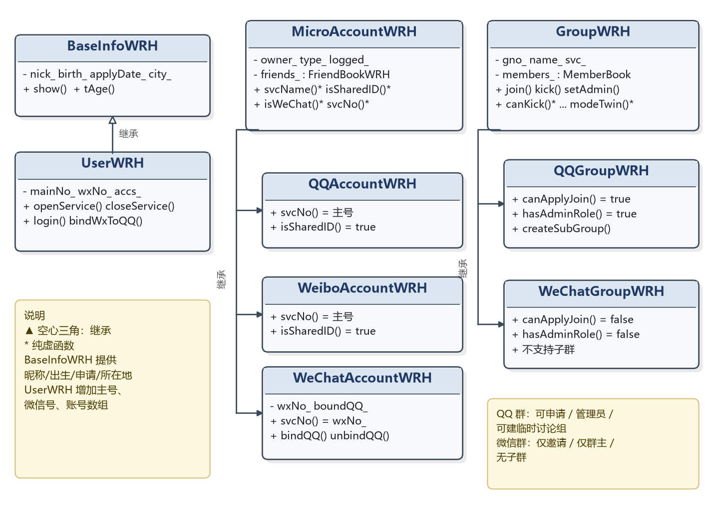
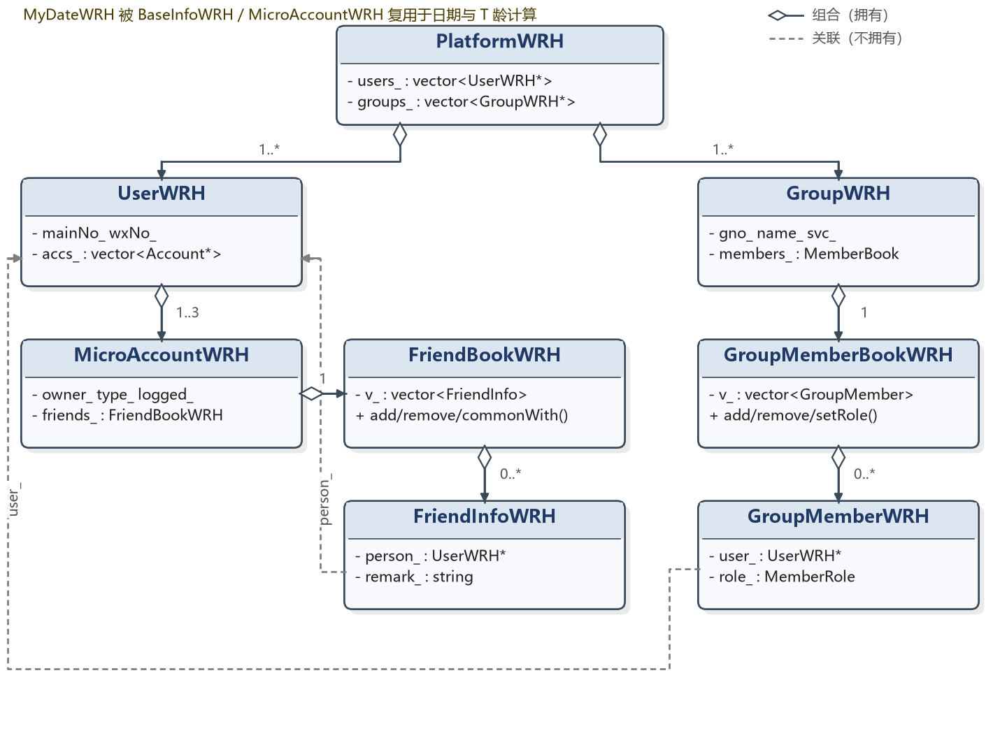
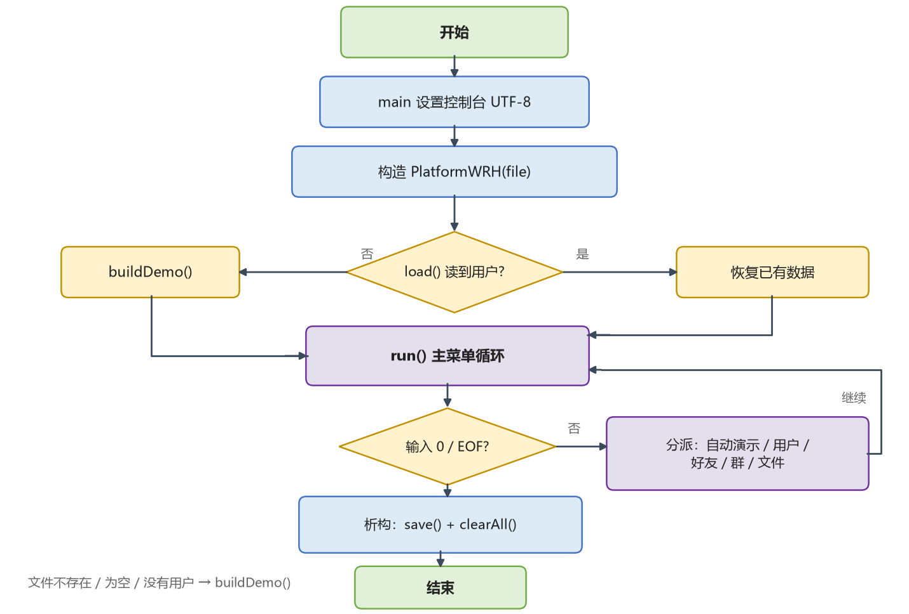

# 模拟即时通信系统实现

## 一、需求分析（设计任务分析）

本课程设计的题目是“模拟即时通信系统实现”：把腾讯公司的 QQ、微博、微信三个微X服务整合到一个统一的立体社交平台中，用面向对象的方法完成用户、好友、群、开通、登录、持久化等功能，并覆盖课程要求的 5 个技术层次。本系统使用 C++17 编写，采用控制台交互，所有类独立成文件，类名统一带姓名缩写 WRH。

### 1.1 设计任务与系统功能

题目要求的功能可以归纳为六个部分。

- **用户基本信息**：每个用户有主号、昵称、出生日期、申请日期（用于计算 T 龄）、所在地，以及好友列表和群列表。
- **号码策略**：QQ 与微博共享同一个主号；微信使用独立微信号，但可以和 QQ 号绑定。其他微X产品也按这两种情况扩展。
- **好友管理**：每个服务各自维护一本好友列表，支持添加、删除、修改备注、查询；可以求两个服务的共同好友；可以依据一个服务的好友，向另一个服务推荐好友。
- **群管理**：每个服务预置 1001～1006 群号，支持加入、退出、踢人、查询成员；QQ 群可以主动申请、有管理员、可以建临时讨论组；微信群只能被邀请/推荐、只有群主有特权、不能建子群；群的管理模式可以动态切换。
- **开通与登录**：一个用户可以开通 N 个微X服务；任意一个服务登录后，本人已开通的其他服务自动登录；支持注销服务和微信绑定 QQ。
- **展示与持久化**：提供数字菜单和一条龙自动演示；数据在程序启动时从文件读入，退出时写回文件，实现断电保存。

对应课程要求的 5 个技术层次，本设计的落点如下表。

| 技术层次 | 本设计的对应实现 |
|---|---|
| 基本层次 | 完成用户、好友、群、开通、登录等基本功能，提供数字菜单和自动演示 |
| 支持对象层次 | 切分出 UserWRH、MicroAccountWRH、GroupWRH、FriendBookWRH、GroupMemberBookWRH 等类，用对象组织数据 |
| 抽象、封装层次 | 抽象出 BaseInfoWRH、MicroAccountWRH、GroupWRH 三个基类；数据成员私有或受保护，通过接口访问 |
| 面向对象层次 | 使用纯虚函数和基类指针实现运行时多态；群管理采用模板方法，差异下沉到派生类 |
| 优化提高层次 | 数字菜单可返回上级；文件 I/O 断点保存；新增服务只需加枚举和子类；群管理模式动态可变；有中文注释和类图；类名带 WRH |

### 1.2 重点与难点分析

本设计的重点不是把功能“堆”出来，而是把三个“同中有异”的服务整理成清晰的类层次，并保证好友、群、文件三处数据始终一致。

- **重点一：类层次划分。** 用户、账号、群、好友记录、群成员记录分别承担什么职责，谁拥有谁，谁只持有指针，必须在动手前想清楚。
- **重点二：差异用多态表达。** QQ/微博共享主号，微信独立号；QQ 群和微信群的加入方式、管理员制度、踢人权限、子群能力都不同。共性放基类，差异放派生类。
- **重点三：数据一致性。** 加好友要双向加，删好友要双向删；注销服务要把好友列表和群成员里的自己一起清掉；文件读入要保证“好友引用的人”和“群的成员”已经存在。
- **重点四：持久化。** 文件要能完整保存用户、开通、绑定、好友、群、群成员六类信息，重启后不丢数据，备注也不能丢。

主要难点及解决思路如下表。

| 难点 | 具体表现 | 解决思路 |
|---|---|---|
| 共享 ID 与独立 ID | QQ/微博的号码相同，微信是另一个号，但微信又能绑定 QQ | 抽象出 MicroAccountWRH，用纯虚函数 svcName/isSharedID/isWeChat/svcNo 表达差异 |
| 每个服务各有一本好友账 | QQ 好友和微信好友不能混在一起，但又要能求交集、做推荐 | 每个账号对象内含一个 FriendBookWRH；共同好友求交集，推荐好友做“有目标服务但还不是目标好友”的筛选 |
| 群规则不同 | QQ 群可申请、有管理员、可建子群；微信群只能邀请、仅群主特权、无子群 | GroupWRH 固定公共流程，纯虚函数表达“能不能做”，QQ/微信派生类分别实现 |
| 注销服务后的残留 | 注销后好友列表、群成员里还可能留着这个人，群主注销后群可能没有群主 | 注销时双向删好友；cleanGroupsAfterClose 清理群成员，群主优先转让给管理员，空群删除 |
| 文件读入顺序 | 好友记录引用两个人，群成员引用用户和群，边读边建会丢关系 | 分六趟读入：用户→开通→绑定→好友→群→成员，保证引用对象先存在 |
| 群管理模式动态变化 | C++ 对象构造后不能原地改变动态类型 | modeTwin 生成“同号同名、成员相同、规则相反”的镜像群，源群数据不动 |
| 构建与编码 | 编译失败留下 0 字节 exe；cmd 下中文乱码 | 构建脚本先编译到临时 exe，成功后再替换；控制台和源码统一 UTF-8 |

### 1.3 技术难点说明

第一，**继承与多态**。BaseInfoWRH 抽取昵称、出生日期、申请日期、所在地，UserWRH 直接继承复用；MicroAccountWRH 抽取账号的拥有者、服务类型、登录状态、申请日期和好友容器，QQAccountWRH、WeiboAccountWRH、WeChatAccountWRH 分别实现号码策略；GroupWRH 抽取群号、群名、所属服务和成员容器，QQGroupWRH、WeChatGroupWRH 分别实现管理规则。平台代码只持有基类指针，调用虚函数时由运行时决定走到哪个派生类，这就是“同一接口，不同行为”。

第二，**模板方法与策略**。群管理有很多公共流程：检查操作者是不是成员、检查目标在不在群里、成功后打印提示、失败时给出原因。这些流程写在 GroupWRH 的 join/requestJoin/inviteJoin/kick/setAdmin/cancelAdmin/quit 里；具体“能不能申请”“能不能踢”“能不能设管理员”“能不能建子群”交给纯虚函数。派生类只回答规则问题，不重复写流程。这些纯虚函数同时也可以看作群管理策略：平台拿着 GroupWRH*，运行时选择 QQ 策略或微信策略。

第三，**好友关系的一致性**。好友关系是双向的：A 把 B 加为好友，B 的列表里也要有 A。备注又是单向的：A 对 B 的备注和 B 对 A 的备注可以不同。因此文件里的 F 记录必须按“有向边”保存，A→B 和 B→A 各写一条；读入时先建好所有用户和账号，再按 F 记录恢复双向关系，最后用后一条记录更新另一侧的备注。

第四，**持久化与引用完整性**。文件里的 F、G、K 记录都引用其他对象。如果按文件顺序边读边建，可能出现“好友的另一端还没建出来”“群的群主还没建出来”的情况。本设计把 load() 拆成六趟，每一趟只处理一种记录，确保引用对象已经存在；同时从已有群号中重新计算临时讨论组的起始号，避免重启后从 2000 重新开始而撞号。

第五，**C++ 工程细节**。类之间互相引用容易造成头文件循环包含，本设计用前向声明加 include guard 解决；拥有堆对象的类在析构函数里统一 delete，并禁用拷贝构造和赋值，避免浅拷贝导致重复释放；输入统一用 askInt/askStr/askLine，处理非法输入、EOF 和空备注；日期用 MyDateWRH 做闰年和大小月校验；控制台统一使用 UTF-8。

## 二、设计（设计方案）

### 2.1 功能模块划分

系统按职责分为六个模块。

| 模块 | 主要类/文件 | 职责 |
|---|---|---|
| 平台控制 | PlatformWRH | 保存用户和群指针，负责菜单调度、自动演示、文件读写 |
| 用户与账号 | UserWRH、MicroAccountWRH 家族 | 用户资料、开通/注销、登录联动、微信绑定、各服务号码策略 |
| 好友 | FriendBookWRH、FriendInfoWRH | 每个账号一本好友账，负责增删改查、共同好友、跨服务推荐 |
| 群 | GroupWRH 家族、GroupMemberBookWRH、GroupMemberWRH | 群的公共流程、QQ/微信规则差异、成员与角色管理、子群、模式切换 |
| 基础信息与工具 | BaseInfoWRH、MyDateWRH、ConstWRH.h、ShortTypes.h | 公共资料、日期与 T 龄、枚举与名字转换、实现代码的短类型别名 |
| 界面与演示 | PlatformWRH::run、menuUser/menuFriend/menuGroup/menuFile/menuOverview、autoDemo/demo* | 数字菜单、输入输出、一条龙自动演示 |

从分层角度看，系统分为六层：控制层（PlatformWRH）、多态层（MicroAccountWRH 家族、GroupWRH 家族）、抽象层（BaseInfoWRH）、容器层（FriendBookWRH、GroupMemberBookWRH）、信息层（FriendInfoWRH、GroupMemberWRH）、工具层（ConstWRH.h、MyDateWRH）。控制层只负责“什么时候调用谁”，不关心 QQ 和微信的具体规则；多态层负责“同一操作的不同实现”；容器层负责“集合的增删查和去重”；信息层是只存数据的小对象；工具层提供枚举、日期等公共能力。这样分层后，新增一个微X服务主要改多态层，平台菜单和容器层可以基本不动。

### 2.2 类图及说明

三类继承关系如图 1 所示。



第一族是**用户信息族**。BaseInfoWRH 保存昵称、出生日期、申请日期和所在地，提供昵称/出生/申请时间/所在地的只读接口和 T 龄计算；show() 是虚函数，派生类可以在公共资料后面追加自己的内容。UserWRH 继承 BaseInfoWRH，增加主号、微信号和已开通账号数组，负责开通、注销、登录联动、微信绑定和资料展示。

第二族是**微X账号族**。MicroAccountWRH 是一个抽象基类，保存账号属于谁、属于哪个服务、是否登录、本号申请时间和本服务的好友容器。它把三个差异做成纯虚函数：svcName() 返回服务名，isSharedID() 表示是否共享主号，isWeChat() 表示是否微信，svcNo() 返回本服务的号码。QQAccountWRH 和 WeiboAccountWRH 的 svcNo() 都返回平台主号；WeChatAccountWRH 用自己的 wxNo_，并额外保存 boundQQ_，空串表示未绑定。每个账号各自维护 FriendBookWRH，所以 QQ 好友和微信好友天然分开。

第三族是**群族**。GroupWRH 保存群号、群名、所属服务和成员容器，公共流程写在基类；kindName()、canApplyJoin()、canCreateSub()、hasAdminRole()、canKick()、canSetAdmin()、manageMode()、createSubGroup()、modeTwin() 是纯虚函数。QQGroupWRH 允许申请、有管理员、群主可设/撤管理员、管理员只能踢普通成员、支持临时讨论组；WeChatGroupWRH 只能邀请/推荐、没有管理员、只有群主能踢人、不支持子群。

组合与关联关系如图 2 所示。



PlatformWRH 拥有全部 UserWRH 和 GroupWRH 对象，析构时统一释放；UserWRH 拥有自己开通的 MicroAccountWRH 对象，析构时逐个 delete；MicroAccountWRH 内含一个 FriendBookWRH，FriendBookWRH 用 vector 按值保存 FriendInfoWRH；GroupWRH 内含一个 GroupMemberBookWRH，后者用 vector 按值保存 GroupMemberWRH。FriendInfoWRH 和 GroupMemberWRH 都只持有 UserWRH*，不拥有用户对象，属于非拥有型关联。这样所有权是一条清晰的树：PlatformWRH → UserWRH → MicroAccountWRH → FriendBookWRH → FriendInfoWRH，另一条是 PlatformWRH → GroupWRH → GroupMemberBookWRH → GroupMemberWRH。拥有堆对象的类都禁用拷贝构造和赋值，避免两个对象指向同一块内存、析构时重复 delete。

### 2.3 数据库定义

本系统没有使用数据库管理系统，而是使用一个 UTF-8 文本文件 platform_data.txt 作为轻量持久层。这样做的原因有三点：题目允许把开通情况、群成员和好友信息保存到文件；文本文件不需要额外依赖，便于检查和演示；每条记录都能直接看懂，方便调试。文件按行组织，一行一条记录，字段之间用空格分隔。记录类型定义如下。

| 记录 | 含义 | 字段 | 约束 |
|---|---|---|---|
| U | 用户资料 | 主号 昵称 出生日期 申请日期 所在地 | 主号唯一；日期为 YYYY-MM-DD，必须是合法日期 |
| O | 开通服务 | 主号 服务 [微信号] | 服务取 QQ/微博/微信；微信多一个独立号 |
| B | 微信绑定 | 主号 绑定QQ | 只有已绑定才写这一行 |
| F | 好友（有向） | 主号A 主号B 服务 备注 | A 对 B 的备注；A→B、B→A 各一条 |
| G | 群 | 群号 群名 服务 群主主号 | 群号+服务唯一；群主必须已存在 |
| K | 群成员 | 群号 服务 成员主号 角色 | 角色 0=成员、1=管理员、2=群主；群主不写 K，由 G 行恢复 |

一个简化的文件示例如下。

```text
U 10001 小腾 1998-05-20 2014-06-01 深圳
O 10001 QQ
O 10001 微博
O 10001 微信 wx10001
B 10001 10001
F 10001 10002 QQ 阿讯(助教)
F 10002 10001 QQ
G 1001 C++程序设计学习群 QQ 10001
K 1001 QQ 10002 1
K 1001 QQ 10003 0
```

字段约束需要特别注意：昵称、所在地、群名用 `>>` 读入，因此不能包含空格；好友备注用 getline 读到行尾，可以包含空格，也可以为空；日期由 MyDateWRH::parse 做闰年和大小月检查；群号和服务的组合用于定位一个群，因为 QQ 群和微信群都可能有 1001；群主由 G 行恢复，K 行只保存管理员和普通成员，避免同一个人既是群主又被写成普通成员。

读文件不是按行顺序边读边建，而是分六趟，顺序如下表。

| 趟次 | 记录 | 目的 |
|---|---|---|
| 1 | U | 先把所有用户建出来，后面所有记录都按主号引用用户 |
| 2 | O | 给用户开通服务，QQ/微博/微信账号对象在这一步建立 |
| 3 | B | 微信账号已经存在，再恢复微信号与 QQ 的绑定 |
| 4 | F | 两端用户和账号都已存在，恢复好友关系和两侧备注 |
| 5 | G | 群主用户已存在，按服务创建 QQGroupWRH 或 WeChatGroupWRH |
| 6 | K | 群已存在，恢复成员和角色 |

这个顺序解决了两个引用完整性问题：好友记录的另一端不会“还没建出来”，群成员也不会找不到群。读完后还要从所有群号中找出最大值，把 tempNo_ 设为这个最大值，保证下次建临时讨论组时不会和已有群号冲突。保存时则按 U/O/B、F、G/K 三段写出：先写所有用户和开通绑定，再写每个用户每个服务下的每一条有向好友记录，最后写群和成员。这样 A 对 B 的备注和 B 对 A 的备注都能保住。

### 2.4 UI 设计

本系统采用控制台界面，不使用 MFC 和可视化开发工具。这样做可以把精力集中在面向对象设计上，也符合题目“不提倡 MFC 和可视化开发”的建议。界面使用数字菜单，主菜单如下。

| 菜单 | 选项 |
|---|---|
| 主菜单 | 1 一条龙自动演示；2 用户管理；3 好友管理；4 群管理；5 数据总览；6 文件读写演示；0 退出 |
| 用户管理 | 1 查看全部用户；2 查看某用户详情；3 开通服务；4 注销服务；5 登录（自动登录全部）；6 全部登出；7 微信绑定 QQ；0 返回 |
| 好友管理 | 1 查看某服务好友列表；2 添加好友；3 删除好友；4 修改备注；5 查询某好友；6 求两个服务的共同好友；7 从其他服务推荐好友；0 返回 |
| 群管理 | 1 查看全部群；2 查看某群成员；3 申请加入；4 邀请/推荐加入；5 踢人；6 设/撤管理员；7 退群；8 查询某人所在群；9 临时讨论组；10 管理模式动态切换；0 返回 |
| 文件演示 | 先 save()，再用一个只读的新平台实例把文件读回来，打印精简总览 |

所有子菜单都支持输入 0 返回上级；主菜单输入 0 或遇到输入流结束（EOF）时退出。输入统一由 askInt/askStr/askLine 处理：askInt 读整数，非法输入返回 -1，EOF 返回 -2；askStr 读不含空格的短串，用于主号、群名；askLine 读一整行，允许空串，用于备注和“直接回车绑定自己的主号”。这样空备注、带空格备注、非法菜单项都不会把输入流弄乱。

为了展示方便，主菜单提供“一条龙自动演示”。自动演示按开通管理、登录管理、好友增删改查、共同好友、跨服务推荐、群管理、模式切换七段依次执行，每段之间和关键步骤之间有停顿，默认一个普通步骤 1000 毫秒，两个大段之间 1500 毫秒，逐行打印列表 125 毫秒。停顿前先 `cout.flush()`，保证文字先显示出来，不会等睡完才一次性吐出。演示开始前调用 buildDemo() 重建一份固定数据，所以每次演示结果可重复；演示结束后打印精简总览，退出时照常写回文件。

### 2.5 设计模式使用

本设计主要使用了以下几类模式和技术。

| 模式/技术 | 使用位置 | 作用 |
|---|---|---|
| 模板方法 | GroupWRH 的 join/requestJoin/inviteJoin/kick/setAdmin/cancelAdmin/quit | 基类固定“检查—执行—提示”的流程，派生类只实现规则 |
| 策略 | QQGroupWRH、WeChatGroupWRH 对 canKick/canSetAdmin/manageMode 等的实现 | 平台持有 GroupWRH*，运行时选择 QQ 或微信的管理策略 |
| 简单工厂 | UserWRH::openService 按 MicroType 创建账号；PlatformWRH::load 按服务创建群 | 调用者只给枚举/服务名，不关心具体 new 哪个类 |
| 组合/聚合 | PlatformWRH 拥有用户和群；UserWRH 拥有账号；账号拥有好友容器；群拥有成员容器 | 形成清晰的所有权树，析构时逐层释放 |
| 多态 | MicroAccountWRH::show/svcNo；GroupWRH::show/kindName | 基类指针调用，运行时走到派生类实现 |
| 分层 | 控制层、多态层、抽象层、容器层、信息层、工具层 | 职责单一，便于扩展和维护 |
| RAII 思想 / 三法则 | 各拥有堆对象的析构函数；禁用拷贝构造和赋值 | 资源所有权明确，避免重复释放 |

模板方法是群管理最核心的设计。以踢人为例，基类只写公共流程，规则由纯虚函数 canKick 决定：

```cpp
bool GroupWRH::kick(UserWRH* actor, UserWRH* who) {
    if (!actor || !who) return false;
    if (!members_.isMember(actor)) return false;   // 公共检查
    if (!canKick(actor, who)) return false;        // 差异交给派生类
    members_.remove(who);                          // 公共动作
    return true;
}
```

QQGroupWRH::canKick 允许群主踢任何人（群主自己除外），允许管理员踢普通成员；WeChatGroupWRH::canKick 只允许群主踢人。以后如果增加“微商群”，只需要再派生一个类实现这些规则，GroupWRH 的流程和平台菜单都不用改，这就是“共性上提、差异下沉”的好处。

## 三、实现（详细设计）

### 3.1 编译环境

- **操作系统**：Windows 11 家庭中文版，版本 10.0.26200。
- **编译器**：MinGW-w64 g++ 15.2.0，支持 C++17。
- **编译选项**：`-std=c++17 -static -static-libgcc -static-libstdc++ -Wall`。其中 -static 系列把运行库静态链接进 exe，双击即可运行，不依赖额外的 DLL；开发过程中还用 `-Wall -Wextra` 做过一次更严格的检查，结果 0 警告 0 错误。
- **源文件组织**：14 个 .cpp 和 17 个 .h，所有类独立成文件，文件头带作者注释；类名统一带 WRH；.cpp 通过 ShortTypes.h 使用 User、Group、Account 等短别名，头文件里的类名仍保持 UserWRH、GroupWRH 等不变。
- **构建脚本**：build_windows.bat 先 `cd /d "%~dp0"` 切到脚本所在目录，再依次在 PATH、C:\mingw64、D:\msys64 中寻找 g++；编译时先输出到 sim_IMWRH.build.exe，只有 g++ 返回 0 才用 move 替换 sim_IMWRH.exe，这样编译失败不会留下 0 字节的 exe。生成的可执行文件约 3.6 MB。
- **编码**：源码和 platform_data.txt 都使用 UTF-8；程序启动时调用 SetConsoleOutputCP(65001) 和 SetConsoleCP(65001)，批处理也执行 chcp 65001，保证中文正常显示。批处理开头的中文注释改成了 ASCII，避免 cmd 在 UTF-8 代码页下把注释误当成命令。

### 3.2 核心流程

程序的核心流程如图 3 所示。



1. main() 先设置控制台 UTF-8，然后构造 PlatformWRH 对象，数据文件名默认为 platform_data.txt。
2. 构造函数先调用 load()：文件存在且至少读到一个用户，就恢复数据；文件不存在、为空或没有用户，就调用 buildDemo() 建一套固化演示数据。
3. run() 进入主菜单循环：打印当前用户数和群数，读取菜单项，分派到自动演示、用户管理、好友管理、群管理、数据总览或文件读写演示；输入 0 或 EOF 时退出循环。
4. 选择自动演示时，autoDemo() 先 buildDemo() 重置为固定数据，再依次执行七段演示，最后用 showBrief() 打印精简总览。
5. PlatformWRH 析构时，如果 autoSave_ 为 true，就调用 save() 把当前数据写回文件，然后 clearAll() 逐个 delete 用户和群。
6. 文件读写演示会先 save()，再用 `PlatformWRH check(file_, false)` 构造一个只读实例，读回文件并打印总览；这个实例的 autoSave_ 为 false，析构时不会再把文件写一遍。

这套流程把“读—用—写”三个时刻分得很清楚：读在构造，用在菜单，写在析构和菜单 6。即使程序在演示中途退出，只要析构函数能执行，数据也会写回文件；如果文件被删掉，下次启动会自动回到固化演示数据。

### 3.3 核心方法

系统中的关键方法如下表。

| 类 | 核心方法 | 作用 |
|---|---|---|
| PlatformWRH | load / save / clearAll | 六趟读文件、三段写文件、释放全部对象 |
| PlatformWRH | run / menuUser / menuFriend / menuGroup / menuFile / menuOverview | 主菜单和各级子菜单的调度 |
| PlatformWRH | buildDemo / autoDemo / demo* | 固化演示数据、七段自动演示 |
| PlatformWRH | recommendFriends | 从源服务好友中筛选“已开通目标服务且还不是目标好友”的人 |
| PlatformWRH | cleanGroupsAfterClose | 注销服务后清理群成员、转让群主、删除空群 |
| UserWRH | openService / closeService | 开通/注销服务，维护账号数组和好友/群的一致性 |
| UserWRH | login / logoutAll / bindWxToQQ | 登录联动、全部登出、微信绑定 QQ |
| MicroAccountWRH | addFriend / delFriend / show | 双向加/删好友，按服务展示账号信息 |
| MicroAccountWRH | svcName / isSharedID / isWeChat / svcNo | 四个纯虚函数，表达号码策略差异 |
| FriendBookWRH | add / remove / setRemark / find / commonWith | 好友容器的增删改查和共同好友 |
| GroupWRH | join / requestJoin / inviteJoin / kick / setAdmin / cancelAdmin / quit / show | 群的公共流程 |
| QQGroupWRH / WeChatGroupWRH | canKick / canSetAdmin / manageMode / createSubGroup / modeTwin | 两套群规则的具体实现 |
| GroupMemberBookWRH | add / remove / find / setRole / list | 群成员和角色管理 |
| MyDateWRH | today / days / diff / parse / str | 当前日期、天数换算、T 龄、合法日期解析 |

方法设计上有几个统一约定：查询类方法尽量声明为 const，只读接口返回 const 引用；会失败的操作返回 bool，由调用者决定提示什么；openService、bindWxToQQ、addFriend 等带 quiet 参数，读文件恢复数据时传 true，避免恢复过程刷屏；PlatformWRH 构造函数带 autoSave 参数，文件读回验证时传 false，析构不覆盖原文件；拥有堆对象的类都禁用拷贝构造和赋值，基类的析构函数声明为 virtual。

### 3.4 核心功能实现

#### 3.4.1 用户与账号管理

UserWRH 保存主号 mainNo_、微信号 wxNo_ 和账号数组 accs_。openService 根据 MicroType 创建具体账号：QQ 创建 QQAccountWRH，微博创建 WeiboAccountWRH，微信创建 WeChatAccountWRH；微信第一次开通时如果没有独立号，就用 `"wx" + 主号` 生成一个，之后复用。QQ 和微博的 svcNo() 都返回 mainNo_，所以两个服务的号码相同；微信的 svcNo() 返回自己的 wxNo_，因此号码不同。bindWxToQQ 通过 dynamic_cast 取到微信账号，把 QQ 号写进 boundQQ_；空串表示未绑定。

注销服务时，除了从 accs_ 里删掉账号，还要遍历该服务好友列表，把“别人列表里的自己”一并删掉，否则对方会留下一个点不开的单向好友。登录时，只要目标服务已开通，就把该用户所有已开通账号置为已登录，实现“一个服务登录，其他服务自动登录”；登录提示会列出全部已开通服务。自动演示中新建用户 10007，依次开通 QQ、微博、微信，验证 QQ 和微博号码相同、微信号不同，再把微信绑定到 QQ，最后注销微博并重复注销一次，观察“已开通服务数”和“未开通无法注销”的提示。

#### 3.4.2 好友管理

每个 MicroAccountWRH 内含一个 FriendBookWRH，FriendBookWRH 用 vector 保存 FriendInfoWRH；一条 FriendInfoWRH 包含好友的 UserWRH* 和“我给他的备注”。添加好友时先检查对方是否开通了同一服务，否则这个服务下根本没有对方的账号；检查通过后，在自己的列表里加一条带备注的记录，在对方列表里加一条备注为空的记录，保证双向。删除好友时两边都删。修改备注只改自己这一侧，所以 A 看 B 和 B 看 A 的备注可以不同。

共同好友由 FriendBookWRH::commonWith 实现：遍历自己的好友列表，看对方列表里有没有同一个人，有就收进结果。跨服务推荐由 PlatformWRH::recommendFriends 实现：先取源服务的好友列表，再筛选“已开通目标服务、但还不是目标服务好友”的人；菜单 3-7 可以选择任意“源服务→目标服务”，自动演示以“微信添加 QQ 推荐好友”为例，添加时备注写“来自QQ推荐”。演示中还会故意让 10006 老马（只开通微信）成为 QQ 好友，addFriend 会提示“尚未开通 QQ，无法成为 QQ 好友”，用来展示前置条件检查。

#### 3.4.3 群管理

每个服务预置 1001～1006 共 12 个群，QQ 群和微信群各一套。GroupWRH 的构造函数会把建群者以 ROLE_OWNER 身份加入成员容器；GroupMemberBookWRH 用 vector 保存 GroupMemberWRH，每条记录包含成员指针和角色。QQ 群支持主动申请（canApplyJoin 返回 true）、有管理员（hasAdminRole 返回 true）、群主可以设/撤管理员、管理员只能踢普通成员、群主可以踢任何人（自己除外）、支持临时讨论组；微信群只能由群内成员邀请/推荐加入、没有管理员、只有群主能踢人、不支持子群。临时讨论组的群号从 tempNo_+1 开始，建成功后 tempNo_ 递增，并加入平台的 groups_ 列表。

自动演示用 QQ 群 1001 和微信群 1001 做对照：QQ 群允许 10007 申请加入，微信群拒绝 10008 的主动申请；微信群群主邀请 10008 成功；QQ 群群主可以把 10007 设为管理员，微信群设管理员被拒绝；QQ 群管理员可以踢普通成员，微信群里普通成员踢人被拒绝、群主踢人成功；QQ 群可以建 2001 临时讨论组，微信群提示不支持；最后查询 10001 加入的所有群。模式切换演示中，QQ 群 1001 调用 modeTwin() 生成一个同号同名、成员相同的微信群规则镜像，打印两边成员数一致，说明“规则变了，成员数据没受伤”，演示完删除镜像群。

注销服务时，PlatformWRH::cleanGroupsAfterClose 会遍历该服务的所有群：如果注销者是普通成员，直接移出；如果注销者是群主，优先把群主转给管理员，没有管理员就转给第一个其他成员，然后把自己移出；如果群里只剩他一个人，整个群删除。这样不会留下“群主已注销、群还在”的悬空数据。

#### 3.4.4 持久化

save() 分三段写文件：第一段写每个用户的 U 行、每个已开通服务的 O 行、微信已绑定时的 B 行；第二段写每个用户每个服务下的每一条好友记录，A→B 和 B→A 各一条，备注分别保存；第三段写每个群的 G 行和除群主外的 K 行。load() 分六趟读入，顺序是 U→O→B→F→G→K，理由已经在 2.3 节说明。读 F 行时先读主号 A、主号 B、服务，再用 getline 把行尾剩余的备注读进来，trim 去掉首尾空白，所以空备注和带空格备注都能正确处理。读完后用已有最大群号重置 tempNo_，避免临时讨论组撞号。

文件读写演示（菜单 6）先 save()，再用 `PlatformWRH check(file_, false)` 构造只读实例。这个实例的 autoSave_ 是 false，析构时不会写回；它读到的用户数、群数和每个用户的好友数会打印出来，和保存前对照，就能验证持久化是否完整。实际运行中，自动演示后得到 8 位用户、13 个群、22 条有向好友记录；退出再重新启动，仍然是 8 位用户、13 个群，各服务好友数不变，说明用户、开通、绑定、好友、群、成员六类信息都恢复成功。

#### 3.4.5 自动演示

自动演示的顺序是：开通管理（新建 10007，开通三个服务，验证共享/独立 ID，绑定微信，注销微博并重复注销）→ 登录管理（10001 全部登出，只在 QQ 登录，观察微博/微信自动登录；再全部登出，改在微信登录）→ 好友增删改查（添加 10005、失败添加 10006、删除 10003、修改 10002 的备注、列出结果）→ 共同好友（QQ 与微博）→ 跨服务推荐（QQ 好友推荐到微信）→ 群管理（申请、邀请、管理员、踢人、子群、查询）→ 模式切换（QQ 群 1001 生成微信群规则镜像）→ 数据总览。

演示开始前 buildDemo() 会重建 6 位基础用户和 12 个预置群；演示过程中再创建 10007、10008 两个用户和 2001 临时讨论组，所以最终是 8 位用户、13 个群。演示的节奏由文件顶部的三个常量控制：DEMO_PAUSE_MS=1000 是普通步骤，DEMO_SECTION_MS=1500 是两个大段之间，DEMO_LINE_MS=125 是逐行打印列表；觉得太快就把 DEMO_PAUSE_MS 调大，觉得太慢就调小。每次停顿前先 flush，避免输出憋在缓冲区里。完整演示大约 47 秒，关键输出包括：

```text
[绑定] 微信号 wx10007 已绑定QQ 10007
[登录] 小腾 在 [QQ] 登录，已开通的 QQ、微博、微信 全部自动登录。
[推荐] 已把 阿豪(wx10004) 添加为微信好友
```

#### 3.4.6 运行与测试

开发过程中做了以下测试，结果均通过。

| 测试项 | 操作 | 结果 |
|---|---|---|
| 编译 | g++ -std=c++17 -Wall -Wextra | 0 警告 0 错误 |
| 自动演示 | 主菜单 1 | 约 47 秒，8 位用户、13 个群、22 条有向好友记录 |
| 持久化读回 | 退出后重新启动；菜单 6 | 8 位用户、13 个群，好友数不变 |
| 空备注 | 添加好友时备注直接回车 | 正常，不吞下一行输入 |
| 带空格备注 | 备注中包含空格 | 正常保存和读回 |
| 注销服务 | 注销 QQ/微博 | 从好友列表和群成员中清理，群主可转让，空群删除 |
| 临时讨论组 | 连续创建 2001、2002 | 不撞号，重启后仍从最大群号往后排 |
| EOF | 输入流结束 | 正常退出并写回文件 |

## 四、相关技术讨论

### 4.1 持久层的使用

本系统选择文本文件而不是数据库，主要是从课程设计的规模和可检查性考虑的。文本文件的优点是透明：打开 platform_data.txt 就能看到每个用户、每条好友关系、每个群的成员；调试时可以直接改一行数据复现问题；不需要安装数据库、配置连接、写 SQL，编译和运行都不依赖外部服务。缺点是它没有事务、没有索引、没有并发控制，写入过程如果被强行中断，文件可能只写了一半；数据量大时，按主号线性查找也会变慢。对于本课程设计的小规模数据（个位数用户、十几个群、几十条好友记录），这些缺点可以接受。

如果要把持久层做得更可靠，可以做三件事。第一，原子写入：先写 platform_data.tmp，关闭文件后再用 rename 覆盖 platform_data.txt，这样即使写到一半崩溃，原文件仍然完整。第二，加版本号和校验：文件头写一个版本号，每条记录可以做简单的字段数校验，读到坏行时跳过并给出提示。第三，换用 SQLite：用户、账号、好友、群、成员各建一张表，用主键和外键保证引用完整性，用事务保证一次保存要么全成功要么全失败，用索引加速按主号查询。SQLite 是单文件数据库，仍然不需要单独的服务器，和本设计的“单机课设”场景很匹配；如果后续要做可视化聊天记录查询，SQLite 会比文本文件更合适。

### 4.2 多线程

本系统的主流程是单线程的：主菜单读取输入、调用业务方法、打印结果，全部在同一个线程里顺序执行。自动演示里的 `std::this_thread::sleep_for` 只是用来控制演示节奏，并没有创建新的线程，也不存在共享数据的竞争。这样做的原因是控制台交互本身就是顺序的：用户输入一个菜单项，程序处理完再打印下一个菜单；文件读写在启动和退出时各发生一次；好友和群的操作都要求“先检查、再修改、再提示”，顺序执行最容易保证一致性。如果为了“用多线程”而强行把菜单、文件、业务拆到不同线程，反而要加锁、要处理输出交错，复杂度和出错概率都会上升。

如果继续完成题目选做的 QQ 点对点 TCP 通信，或者课后的可视化多人聊天，多线程就有必要了。一个可行的划分是：主线程负责界面和用户输入；一个接收线程阻塞在 recv 上，收到消息后放进消息队列；发送可以在主线程直接 send，也可以单独开一个发送线程；共享的好友列表、群成员列表、消息记录用 std::mutex 保护，用 std::lock_guard 管理锁的生命周期，避免手动 lock/unlock 漏掉；接收线程和界面线程之间用 std::condition_variable 通知新消息；用一个 std::atomic<bool> 作为退出标志，退出时先置 false，再 join 所有线程。网络编程还需要 WSAStartup、socket、bind、listen、accept、connect、send、recv，以及消息边界处理（固定长度头或换行分隔），这些都属于后续扩展，本设计没有实现，但类结构已经为“账号—好友—群—消息”留出了扩展空间。

### 4.3 容器的使用

本系统主要使用了 vector、map、set 三种标准容器，以及两个自定义容器类。

- **vector**：PlatformWRH 用 `vector<UserWRH*>` 保存全部用户，用 `vector<GroupWRH*>` 保存全部群；UserWRH 用 `vector<MicroAccountWRH*>` 保存已开通账号；FriendBookWRH 用 `vector<FriendInfoWRH>` 保存好友记录；GroupMemberBookWRH 用 `vector<GroupMemberWRH>` 保存成员记录。vector 内存连续、遍历方便、按下标访问快，适合这种“数量不大、经常整体打印”的场景。
- **map**：load() 用 `map<string, User*>` 按主号查找用户。读 F、G、K 行时，需要频繁地“给一个主号，找对应用户”，map 的 O(log n) 查找比每次遍历 vector 的 O(n) 更合适；而且 map 按主号有序，调试时输出也稳定。
- **set**：UserWRH::openedSet() 返回 `set<MicroType>`，用来表示已开通服务的集合；集合天然去重，拼成“QQ、微博、微信”这样的字符串也方便。ConstWRH.h 里的 openedToStr 就按枚举顺序遍历集合。
- **自定义容器**：FriendBookWRH 和 GroupMemberBookWRH 把 vector 包装起来，对外只暴露 add/remove/find/setRemark/commonWith 等接口，保证“好友不重复”“成员不重复”“删除时能找到并删除”这些不变量。这样上层代码不需要直接操作 vector，也不会忘记去重或忘记双向删除。

从复杂度看，FriendBookWRH 和 GroupMemberBookWRH 的查找、删除是 O(n)，因为数据量小，线性扫描足够；如果以后好友数上千，可以把 vector 换成 unordered_map<UserWRH*, FriendInfoWRH>，把查找降到平均 O(1)，但会失去按加入顺序打印的便利，需要额外维护顺序。当前设计选择 vector，是在“数据量小、代码简单、顺序稳定”之间做的权衡。内存所有权方面，PlatformWRH、UserWRH 拥有指针并负责 delete；FriendInfoWRH、GroupMemberWRH 只存非拥有型指针；容器按值存记录，记录很小，复制成本低。拥有堆对象的类都禁用拷贝，避免两个容器同时认为自己是某块内存的主人。

### 4.4 其他技术

**前向声明与 include guard。** 类之间互相引用时，如果头文件互相 include，很容易循环包含。本设计的做法是：头文件里能只写 `class UserWRH;` 就只写前向声明，只有真正需要完整类型的地方（比如调用成员函数、按值保存对象）才 include 对应的头文件；每个头文件都有 `#ifndef ... #define ... #endif` 保护。这样既减少了编译依赖，也避免了循环包含。

**资源所有权与三法则。** PlatformWRH 拥有 users_ 和 groups_，UserWRH 拥有 accs_，GroupWRH 拥有 members_，这些类都在析构函数里逐个 delete，并禁用拷贝构造和赋值。基类 BaseInfoWRH、MicroAccountWRH、GroupWRH 的析构函数都声明为 virtual，保证通过基类指针 delete 派生对象时能走到派生类的析构函数。严格说这不是现代 C++ 的 RAII（因为用的是裸指针），但“谁 new 谁 delete、谁拥有谁释放”的规则是清楚的；如果改用 `std::unique_ptr`，可以进一步免去手动 delete。

**const 正确性。** 只读接口返回 const 引用，比如 `const std::string& nick() const`；不会修改对象的方法声明为 const，比如 `int count() const`、`bool isMember(UserWRH*) const`；参数能传 const 引用就不传值。这样编译器能帮忙检查“不该改的地方有没有被改”，也让接口的语义更清楚。

**输入与日期。** askInt 用 `cin >> x` 读整数，失败时 clear 并 ignore 掉整行，返回 -1；遇到 EOF 返回 -2，菜单看到 -2 就退出。askLine 用 getline 读整行，允许空串，再用 trim 去掉首尾空白，所以备注可以空、可以带空格。日期类 MyDateWRH 自己实现闰年判断和每月天数检查，parse 会拒绝 2 月 30 日这样的非法日期；days() 用 Howard Hinnant 的 civil 算法把年月日换算成距 1970-01-01 的天数，两个日期相减就是整数减法，T 龄计算不需要逐月数天数。

**UTF-8 与构建。** 程序启动时调用 `SetConsoleOutputCP(65001)` 和 `SetConsoleCP(65001)`，批处理执行 `chcp 65001`，源码和文本文件都保存为 UTF-8。构建脚本用 `-static` 系列选项生成不依赖 DLL 的 exe，先编译到临时文件、成功后再 move，避免编译失败留下 0 字节文件；脚本开头用 `cd /d "%~dp0"` 保证从任何目录双击都能找到源码。批处理的注释改成 ASCII，是因为 cmd 在 UTF-8 代码页下读带中文的 rem 行时可能出现解析错位，把半行中文当成命令执行；中文提示仍然保留在 echo 里。

**短类型别名。** 题目要求类名带姓名缩写 WRH，所以头文件里的类名保持 UserWRH、GroupWRH 等不变；但实现代码如果满屏 WRH，可读性会下降。ShortTypes.h 用 `using User = UserWRH;` 这样的类型别名，让 .cpp 里可以写 User、Group、Account、FriendBook 等短名。类型别名只是编译期的第二个名字，不产生新类型、不增加运行开销，也不影响继承和多态。需要注意的是，构造函数和析构函数的定义必须写真实类名，比如 `UserWRH::UserWRH`、`UserWRH::~UserWRH`，因为 `User::User` 里的第二个 User 会被编译器当成类型名而不是构造函数名；这是 C++ 的语法规定，不是漏改。

## 五、难点问题讨论

开发过程中遇到的问题、原因和解决办法汇总如下。

| 难点 | 原因 | 解决办法 | 验证 |
|---|---|---|---|
| 好友关系重载后丢失 | 旧版保存只写主号较小的一侧，读入又是单趟，另一端还没建出来 | 保存时 A→B、B→A 各写一条；读入分六趟，先建用户和账号，再恢复好友 | 重启后好友数和备注不变 |
| 注销服务后群成员残留 | 注销只删了账号，群成员容器里还留着用户指针 | cleanGroupsAfterClose：普通成员移出；群主转让给管理员或第一个成员；空群删除 | 注销后群成员数正确，无空群 |
| 群管理模式不能原地切换 | C++ 对象构造后不能改变动态类型 | modeTwin 生成同号同名、成员相同的镜像群，规则相反；源群不动 | 镜像群成员数与源群一致 |
| 跨服务推荐好友 | 需要同时判断“有目标服务账号”和“还不是目标好友” | recommendFriends 遍历源好友，用 hasService 和 isFriend 双重过滤 | QQ→微信推荐成功，重复推荐不会重复加 |
| 空备注/带空格备注 | `>>` 读到空格就停，空行会吞掉下一行输入 | askLine 用 getline；askInt 读完 ignore 整行；F 行用 getline 读备注并 trim | 空备注、带空格备注均正常 |
| 临时讨论组群号冲突 | 重启后 tempNo_ 从 2000 重新开始，可能和已有 2001 撞号 | load() 结束后取所有群号最大值重置 tempNo_ | 连续建 2001、2002 后重启仍不撞号 |
| 0 字节 exe / 无法运行 | 旧脚本直接写 sim_IMWRH.exe，编译失败会留下半成品 | 先写 sim_IMWRH.build.exe，成功后再 move；失败保留旧 exe | 编译失败时旧 exe 仍可运行 |
| 中文乱码 / 批处理报错 | 控制台默认编码不是 UTF-8；cmd 读 UTF-8 中文 rem 行可能错位 | SetConsoleOutputCP/SetConsoleCP + chcp 65001；批处理 rem 改 ASCII | 菜单、提示、文件中文均正常 |

其中好友一致性和群模式切换是最需要解释的两个问题。

好友一致性的关键在于“有向保存、分趟加载”。A 把 B 加为好友时，A 的列表里有一条带备注的记录，B 的列表里也有一条备注为空的记录。如果只保存 A 的列表，B 对 A 的备注就会丢；如果按文件顺序单趟读，读到 A→B 时 B 可能还没建出来，这条关系就会被跳过。现在的做法是：保存时把每个用户每个服务下的每条好友记录都写出来，A→B 和 B→A 各一条；读入时第一趟先把所有 U 行建成用户，第二趟开通服务，第三趟恢复微信绑定，第四趟才处理 F 行。处理 F 行时，如果 A 的列表里还没有 B，就同时给 A 和 B 各加一条；如果已经有了，就只更新 A 这一侧的备注。这样无论文件里两条 F 行的先后顺序如何，最终两边的关系和备注都能恢复。

群管理模式切换的关键在于“C++ 对象不能原地变类型”。`QQGroupWRH` 对象构造出来就是 QQ 群，不能通过赋值把它变成 `WeChatGroupWRH`。本设计的 modeTwin() 采用“镜像群”方案：新建一个同号同名、群主相同、成员相同的另一种群对象，把原群成员逐个搬过去（原管理员在微信群里降为普通成员），然后打印两边成员数一致。源群的成员容器没有被修改，所以“成员数据不受伤”；镜像群展示的是另一种管理规则，演示完就 delete。这个方案能说明“管理模式可以随平台发展动态变化”，但也有一点局限：镜像群是临时对象，没有替换平台 groups_ 里的原群。如果要求永久切换，可以在 PlatformWRH 里增加一个“替换群对象”的接口，把原群删除、把镜像群指针放回原位置，并同步文件；这是后续可以改进的地方。

## 六、收获和展望

### 6.1 收获

这次课程设计让我把课堂上的“抽象、封装、继承、多态”真正用到了一个能跑起来的系统里。以前写题时，继承和多态往往只是语法题；这次要自己判断哪些字段应该放基类、哪些行为应该做成纯虚函数、哪些类应该组合、哪些类只应该持有指针。比如 MicroAccountWRH 把“号码策略”抽象成四个纯虚函数，QQ/微博/微信的差异就集中到三个很小的派生类里；GroupWRH 把“检查—执行—提示”的流程固定下来，QQ 群和微信群的差异只用 canKick/canSetAdmin 等几个函数表达。这种“共性上提、差异下沉”的思路，比单独背设计模式的定义更有体会。

在工程能力上，我学会了用六趟加载解决引用完整性问题，用有向记录保存双向好友关系，用析构函数和禁用拷贝管理资源所有权，用前向声明和 include guard 拆循环依赖，用 askInt/askLine 处理非法输入和空备注，用 UTF-8 和静态链接解决中文与运行环境问题。调试构建脚本的过程也让我意识到，编译成功不等于程序可用：输出文件是否完整、exe 是否能双击运行、控制台编码是否正确，都需要实际验证。自动演示和文件读回演示则让我学会把“功能”做成可重复、可检查的流程，而不是每次手工点菜单。

### 6.2 不足

本设计还有以下不足。第一，界面是控制台，交互效率不高，也不够直观；第二，主流程是单线程，没有实现题目选做的 TCP 点对点通信，也没有多线程聊天；第三，持久层是文本文件，没有事务和原子写入，写到一半崩溃可能留下不完整文件；第四，平台和用户等类使用裸指针 new/delete，虽然析构和禁用拷贝保证了正确性，但不如智能指针安全；第五，群管理模式切换目前用镜像群演示，没有永久替换原群；第六，昵称、所在地、群名不能包含空格，这是文本格式的限制；第七，没有正式的单元测试，主要靠自动演示和手工测试覆盖。

### 6.3 展望

后续可以从几个方向继续完善。功能上，补上题目选做的 QQ 点对点 TCP 通信，进一步做多人聊天、聊天记录查询；技术上，用多线程把界面、接收、发送分开，用 mutex 和 condition_variable 保护共享数据；界面上，用 Qt 或 Web 前端替换控制台，做出更直观的好友列表和群聊窗口；存储上，把文本文件换成 SQLite，用事务和索引保证一致性，支持按时间、关键字查询聊天记录；代码上，用 unique_ptr 管理所有权，用 CMake 组织构建，补单元测试和持续集成；扩展上，按 ConstWRH.h 里的 MicroType 继续增加微商、微唱、微走等产品，只需要加枚举和派生类，平台主体不用大改。

总的来说，这次课程设计让我从“会写 C++ 语法”往“会设计一个可维护的面向对象系统”迈了一步。类层次、数据一致性、持久化和调试经验，都是以后做更大项目的基础。
